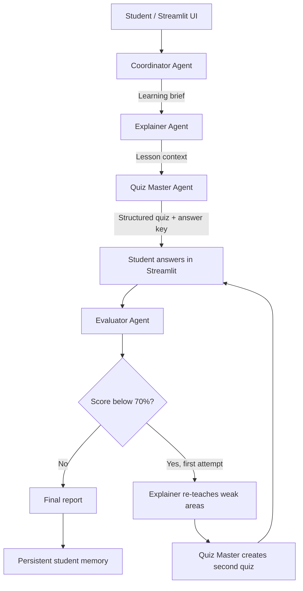

# 🦁 Leo — Multi-Agent AI Tutor

Leo is a collaborative AI tutor built with **CrewAI, Groq (GPT-OSS 120B), Python, and Streamlit**. Four specialist agents coordinate a learning session: Coordinator, Explainer, Quiz Master, and Evaluator.

## Features

- Four distinct agents, each with a dedicated role, goal, backstory, and task prompt.
- Sequential CrewAI orchestration with explicit task context handoffs.
- Structured quiz and evaluation outputs using Pydantic.
- Student memory stored locally in `data/student_memory.json`.
- Interactive Streamlit quiz: the student submits their own answers.
- Bonus feedback loop: scores below 70% trigger targeted re-teaching and a second quiz.
- API key stored in `.env`; `.env` is excluded from Git.

## Architecture



## Agent roles

| Agent | Responsibility |
|---|---|
| Coordinator | Understands the topic, identifies learning objectives, and creates the brief for downstream agents. |
| Explainer | Teaches the concept with steps, examples, common mistakes, and a recap. |
| Quiz Master | Creates exactly five MCQs with four options, answer keys, explanations, concepts, and difficulty labels. |
| Evaluator | Checks submitted answers, calculates a score, identifies strengths and weak areas, and recommends next steps. |

## Orchestration pattern and handoffs

Leo uses **sequential orchestration** (`Process.sequential`) for the lesson pipeline. The Coordinator task output is passed to the Explainer through `Task.context`. The Coordinator and Explainer outputs are passed to the Quiz Master through `Task.context`. The Quiz Master produces a Pydantic `QuizPack`, which Streamlit displays to the student. After the human submits answers, the quiz and answer key are explicitly passed into the Evaluator task. This is a real data handoff between specialist agents, not four unrelated chatbot responses.

The interactive student step is outside the Crew execution because the application must wait for the student's actual answers before evaluation.

## Memory

`memory.py` persists each student's name, topics studied, scores, weak areas, and session summaries in `data/student_memory.json`. The application loads this record at the start of a session and passes the relevant memory summary into the Coordinator, Explainer, and Evaluator prompts. This is application-level persistent memory; it is separate from CrewAI's optional vector-store memory feature.

## Requirements

- Python 3.10–3.13 (Python 3.11 recommended)
- A Groq API key
- Internet connection for Groq API requests

## Setup — Windows / VS Code

1. Clone or download this repository.
2. Open the project folder in VS Code.
3. Create and activate a virtual environment:

   ```powershell
   py -3.11 -m venv .venv
   .\.venv\Scripts\Activate.ps1
   ```

   If PowerShell blocks activation:

   ```powershell
   Set-ExecutionPolicy -Scope Process -ExecutionPolicy Bypass
   .\.venv\Scripts\Activate.ps1
   ```

4. Install dependencies:

   ```powershell
   python -m pip install --upgrade pip
   pip install -r requirements.txt
   ```

5. Copy `.env.example` to `.env` and add your key:

   ```env
   GROQ_API_KEY=your_real_groq_api_key
   ```

6. Run Streamlit:

   ```powershell
   python -m streamlit run app.py
   ```

7. Open the local URL printed in the terminal (normally `http://localhost:8501`).

## Demo walkthrough (3–5 minutes)

1. Open Leo and enter a student name, topic (for example, Python OOP), and level.
2. Start the lesson. Show the Coordinator, Explainer, and Quiz Master activity.
3. Expand the Coordinator's learning plan and show the lesson.
4. Continue to the quiz and submit answers. For a clear bonus demonstration, intentionally answer several questions incorrectly.
5. Show the Evaluator's score, feedback, and weak concepts.
6. Start the bonus feedback loop. Show the Explainer's targeted revision and the Quiz Master's second quiz.
7. Submit the second quiz and show the final report and saved student history.

## GitHub safety checklist

- Never commit `.env`.
- Confirm `.env` is listed in `.gitignore`.
- Commit `.env.example`, not the real key.
- Do not put API keys in screenshots or demo recordings.
- `data/student_memory.json` is ignored because it may contain student information.

## Troubleshooting

**GROQ_API_KEY is missing**  
Check that `.env` is in the project root, the variable is spelled `GROQ_API_KEY`, and Streamlit was restarted after editing it.

**Model not available / API error**  
Check the current model availability in the Groq console. This project configures `groq/openai/gpt-oss-120b` in `config.py`. Groq announced that `llama-3.3-70b-versatile` was shut down for free/developer tiers on August 16, 2026, and recommends `openai/gpt-oss-120b` as its replacement. If your Groq enterprise account still has Llama 3.3 access, you can change `MODEL_NAME` to `groq/llama-3.3-70b-versatile`.

**PowerShell activation is blocked**  
Use the process-scoped execution policy command shown above, or activate the environment from Command Prompt with `.venv\\Scripts\\activate.bat`.

**Structured output parsing failed**  
Retry the task. If it continues, check the CrewAI/LiteLLM package installation and the provider's model availability.

## Project structure

```text
Leo-AI-Tutor/
├── app.py
├── main.py
├── agents.py
├── crew.py
├── models.py
├── memory.py
├── config.py
├── requirements.txt
├── .env.example
├── .gitignore
├── README.md
└── data/
```

## Academic note

This is an educational demonstration. AI-generated explanations and grading can be imperfect. Students should verify important academic facts against their course materials.
